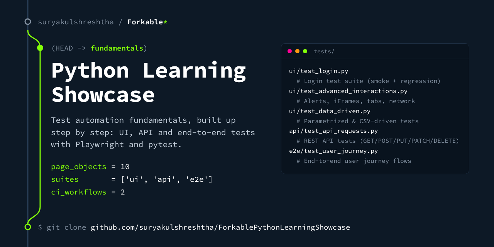

<!-- forkable-card:start (added by apply_cards.py; re-run it to update) -->

<!-- forkable-card:end -->

# 🎭 Playwright Pytest Automation Framework

[](https://github.com/suryakulshreshtha/ForkablePythonLearningShowcase/actions/workflows/ci.yml)
[](https://github.com/suryakulshreshtha/ForkablePythonLearningShowcase/actions/workflows/live-sites.yml)

> **A production-grade test automation framework** built with Playwright + Python + pytest  
> Covers UI, API, E2E testing — with Page Object Model, data-driven tests, CI/CD, and parallel execution.

[](https://www.python.org/downloads/)
[](https://playwright.dev/python/)
[](https://docs.pytest.org/)

---

## 📁 Project Structure

```
ForkablePythonLearningShowcase/
│
├── .github/
│   └── workflows/
│       └── playwright-tests.yml    # GitHub Actions CI/CD pipeline
│
├── pages/                          # Page Object Model (POM)
│   ├── base_page.py               # Base class — all shared actions
│   ├── login_page.py              # Login Page Object
│   ├── secure_page.py             # Secure Area Page Object
│   ├── home_page.py               # Home / landing page
│   ├── checkbox_page.py           # Checkboxes
│   ├── dropdown_page.py           # Dropdown
│   ├── table_page.py              # Data tables
│   ├── dynamic_loading_page.py    # AJAX / dynamic content
│   ├── drag_drop_page.py          # Drag and drop
│   └── alerts_page.py             # JS alerts / confirms / prompts
│
├── tests/
│   ├── ui/
│   │   ├── test_login.py          # Login test suite (smoke + regression)
│   │   ├── test_advanced_interactions.py  # Alerts, iFrames, tabs, network
│   │   └── test_data_driven.py   # Parametrized & CSV-driven tests
│   ├── api/
│   │   └── test_api_requests.py  # REST API tests (GET/POST/PUT/PATCH/DELETE)
│   └── e2e/
│       └── test_user_journey.py  # End-to-end user journey flows
│
├── fixtures/
│   └── login_data.csv             # External test data
│
├── utils/
│   └── helpers.py                 # Reusable utility functions
│
├── conftest.py                    # ⭐ Fixtures, hooks, CLI options
├── pytest.ini                     # Pytest configuration & markers
├── requirements.txt               # Python dependencies
├── .env.example                   # Environment variable template
├── .gitignore                     # Files excluded from Git
├── docs/COURSE_NOTES.md            # Comprehensive course notes
├── scripts/                        # Publish helpers (push_to_github.*)
├── LICENSE                         # MIT
└── CHANGELOG.md                    # Version history
```

---

## 🚀 Quick Start

### Prerequisites

- Python 3.9+ installed
- Git installed
- A terminal (Command Prompt / PowerShell / bash / zsh)

### Step 1 — Clone the Repository

```bash
git clone https://github.com/suryakulshreshtha/ForkablePythonLearningShowcase.git
cd ForkablePythonLearningShowcase
```

### Step 2 — Create & Activate Virtual Environment

```bash
# Create virtual environment
python -m venv venv

# Activate (Windows)
venv\Scripts\activate

# Activate (macOS / Linux)
source venv/bin/activate
```

### Step 3 — Install Dependencies

```bash
pip install -r requirements.txt
playwright install
playwright install-deps   # Linux only
```

### Step 4 — Configure Environment

```bash
cp .env.example .env
# Edit .env with your settings (optional — defaults work out of the box)
```

### Step 5 — Run Tests

```bash
# Run smoke tests (fastest — ~30 seconds)
pytest -m smoke

# Run all tests
pytest

# Run with HTML report
pytest --html=reports/report.html --self-contained-html

# Run API tests only
pytest -m api

# Run in parallel (4x faster)
pytest -n auto

# Run a specific test file
pytest tests/ui/test_login.py -v

# Run headed (see the browser)
pytest --headless=false -m smoke
```

---

## 🎯 Test Markers

| Marker | Description | Run Command |
|---|---|---|
| `smoke` | Critical path — the quick first run | `pytest -m smoke` |
| `regression` | Full suite — runs before release | `pytest -m regression` |
| `ui` | Browser-based UI tests | `pytest -m ui` |
| `api` | API / HTTP layer tests | `pytest -m api` |
| `e2e` | End-to-end flow tests | `pytest -m e2e` |
| `data_driven` | Tests reading external data | `pytest -m data_driven` |
| `login` | Authentication tests | `pytest -m login` |
| `slow` | Tests taking > 30 seconds | `pytest -m "not slow"` |

### CI in two workflows

`ci.yml` gates every push and pull request on what this repository controls: Ruff, test collection and the API tests. `live-sites.yml` runs the browser tests (`smoke`, then `regression`) against the-internet.herokuapp.com, weekly and on demand, and has its own badge. That site is not ours, and from a shared GitHub runner it can be slow or unreachable, so a red Live sites badge means "go and look at the site", not "your change is broken".

---

## 🔑 Key Concepts Demonstrated

- ✅ Page Object Model (POM) with Base Page
- ✅ pytest fixtures (function/session scope)
- ✅ Screenshot on test failure (automatic)
- ✅ Auth state reuse (login once per suite)
- ✅ Parametrized and data-driven tests
- ✅ API testing with `APIRequestContext`
- ✅ Network interception and mocking
- ✅ iFrame interaction
- ✅ Multiple tabs / windows
- ✅ JS Alerts / Confirms / Prompts
- ✅ File upload
- ✅ Drag and drop
- ✅ Parallel execution (pytest-xdist)
- ✅ HTML reporting (pytest-html)
- ✅ GitHub Actions CI/CD

---

## 📖 Full Course Notes

See [`docs/COURSE_NOTES.md`](./docs/COURSE_NOTES.md) for comprehensive notes covering every concept in depth.

---

## 🤝 Author

**Surya Kulshreshtha**  
GitHub: [@suryakulshreshtha](https://github.com/suryakulshreshtha)
